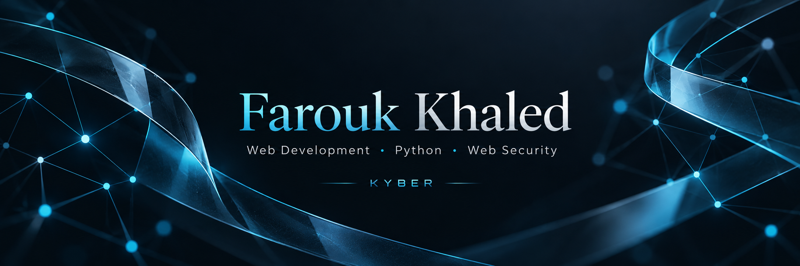

  

<strong>Practical projects. Clear scope. Continuous learning.</strong>

I’m **Farouk Khaled**, a web developer working with React and Python, developing full-stack skills and exploring web application security.

## Selected projects

### [Circle · React social app](https://github.com/faroukkhaled/route-social-react)
A responsive social interface with authentication flows, posts, comments, image uploads and a local demo.

**React · React Router · Vite · JavaScript · REST API integration**

Built as a Route learning project. The frontend integrates with the Route API; it does not include a custom backend. [Explore the project →](https://github.com/faroukkhaled/route-social-react#readme)

### [Python · Reflected-input scanner](https://github.com/faroukkhaled/xss_scanner.py)
An educational tool for exploring HTTP requests, HTML parsing, URL query parameters and threading.

**Python · requests · BeautifulSoup · Web security fundamentals**

Results identify reflected input for manual review, not confirmed exploitable XSS. Use only within an explicitly authorized testing scope. [Read the documentation →](https://github.com/faroukkhaled/xss_scanner.py#readme)

## Building KYBER

**KYBER** is an initiative I’m developing around practical web and digital solutions for businesses in Qatar. It is currently a work in progress.

My focus is on useful interfaces, API integration and thoughtful handling of user data, while building the backend skills needed for complete applications.

## How I work

- **Build clearly:** readable code, reusable components and documented setup.
- **Learn by doing:** practical projects with an honest account of what has been tested.
- **Think about security:** protect credentials, respect user data and test only with permission.

---

أنا <strong>فاروق خالد</strong>، مطوّر ويب أعمل باستخدام React وPython، وأطوّر مهاراتي في Full-Stack وأمن تطبيقات الويب. أعمل على تطوير <strong>KYBER</strong> لتقديم حلول ويب ورقمية عملية للشركات في قطر. المشاريع هنا توضّح شغلي الحالي ونطاقه وما أتعلمه.

